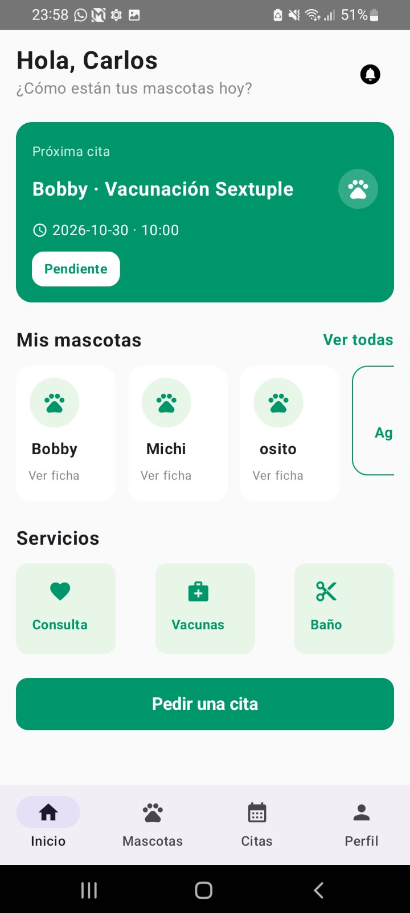
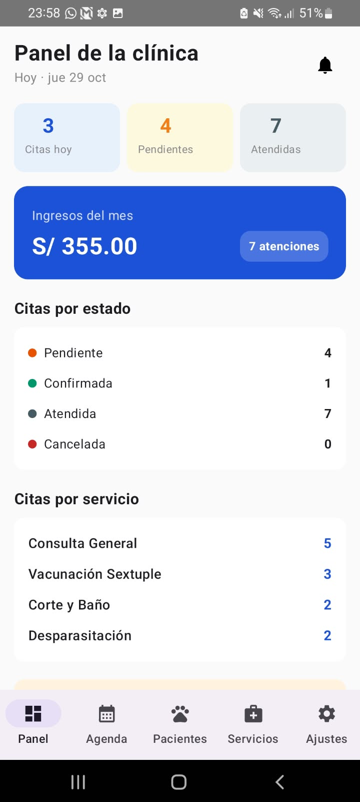
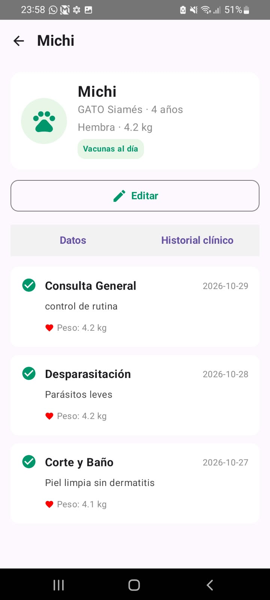
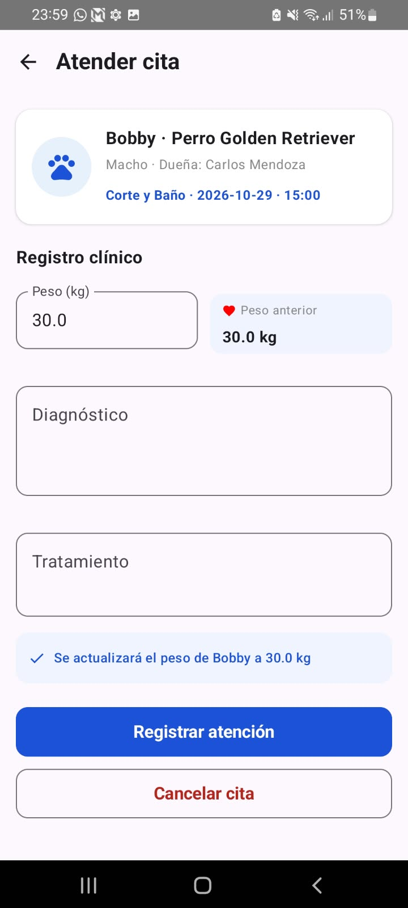
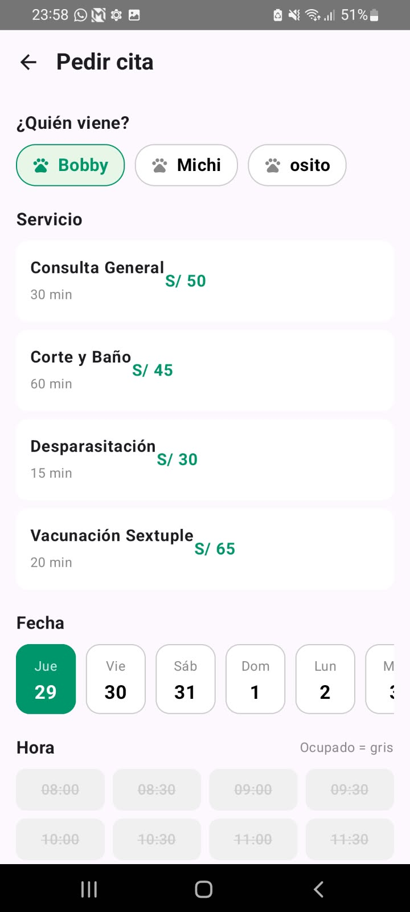
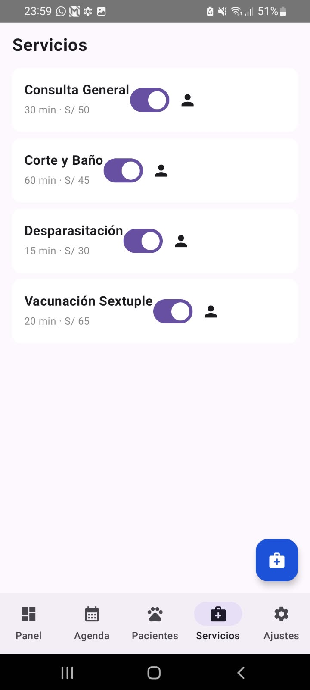

# HuellitasVet 🐾 - Sistema de Gestión Veterinaria

HuellitasVet es una aplicación móvil desarrollada en Kotlin y Jetpack Compose orientada a la gestión integral de atenciones veterinarias, agendamiento de citas y control de historiales clínicos para mascotas, soportando roles diferenciados para Clientes (Dueños) y Médicos Veterinarios (Administradores).

---

## 🏗️ Arquitectura y Árbol de Paquetes

La aplicación sigue el patrón **MVVM (Model-View-ViewModel)** junto con **Clean Architecture** estructurada por capas:

com.tecsup.huellitasvet/
├── data/
│   ├── local/
│   │   ├── dao/          # UsuarioDao, MascotaDao, CitaDao, ServicioDao
│   │   ├── entity/       # Entidades Room (Usuario, Mascota, Cita, Servicio)
│   │   ├── relation/     # CitaConDetalle, MascotaConDueno
│   │   ├── DatosIniciales.kt
│   │   └── VetDatabase.kt
│   ├── prefs/            # PreferenciasStore (DataStore)
│   └── repository/       # VetRepositoryImpl.kt
├── model/                # Enums (Rol, EstadoCita, Especie, Sexo)
├── ui/
│   ├── dueno/            # Pantallas y vistas del perfil Cliente
│   ├── veterinario/      # Pantallas y vistas del perfil Veterinario
│   ├── components/       # Componentes reutilizables de UI
│   └── theme/            # Color, Theme, Type
├── viewmodel/            # SesionViewModel, MascotaViewModel, CitaViewModel, etc.
└── MainActivity.kt

---

## 📐 Diagrama MVVM

       ┌──────────────────────┐
       │     UI (Compose)     │
       └──────────┬───────────┘
                  │ Observa (StateFlow)
                  ▼
       ┌──────────────────────┐
       │      ViewModel       │
       └──────────┬───────────┘
                  │ Invoca Corrutinas
                  ▼
       ┌──────────────────────┐
       │      Repository      │
       └──────────┬───────────┘
                  │ Consultas suspend
                  ▼
       ┌──────────────────────┐
       │   Room DB / DataStore│
       └──────────────────────┘

---

## 💡 Respuestas: 'Para pensar'

1. **¿Por qué se utiliza Room con corrutinas en lugar de consultas síncronas en el hilo principal?**
    * *Respuesta:* Para evitar congelar la interfaz de usuario (UI Thread) y prevenir errores `ANR (Application Not Responding)`. Todas las operaciones de E/S a la base de datos de SQLite se delegan al Dispatcher de I/O en segundo plano.

2. **¿Cómo se asegura la consistencia entre los roles en el inicio de sesión?**
    * *Respuesta:* `SesionViewModel` valida la contraseña en Room y contrasta directamente el enum del `Rol` registrado en la base de datos contra el selector seleccionado en la UI, bloqueando accesos cruzados.

3. **¿De qué manera garantiza DataStore la persistencia del estado?**
    * *Respuesta:* Preserva de forma asíncrona mediante un flujo de clave-valor la sesión activa del usuario (ID y Rol) y la preferencia del tema visual (Modo Oscuro), permitiendo restaurar la app en su último estado guardado.

---

## 📸 Capturas de Pantalla

| Vista | Perfil Cliente               | Perfil Veterinario           |
|---|------------------------------|------------------------------|
| **Principal** |     |      |
| **Detalle / Ficha** |  |     |
| **Gestión / Citas** |      |  |