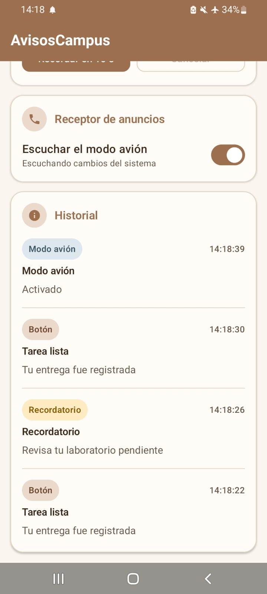

# AvisosCampus

App Android que muestra notificaciones locales, programa un recordatorio con corrutinas y escucha el modo avión con un `BroadcastReceiver`. Todo queda registrado en un historial.

**Tecnología:** Kotlin · Jetpack Compose · Material 3 (tema marrón claro) · MVVM + Repository

## Estructura

```
com.ponce.avisoscampus/
├── AvisosApp.kt
├── MainActivity.kt
├── model/Modelos.kt
├── data/AvisosRepository.kt
├── notificacion/Notificador.kt
├── receiver/ModoAvionReceiver.kt
├── viewmodel/{AvisosViewModel, AvisosViewModelFactory}.kt
└── ui/{PantallaAvisos, HistorialAvisos}.kt + theme/
```

## Arquitectura

```
View (PantallaAvisos) --eventos--> ViewModel --registra--> Repository (interface)
        ^                              |
        |--- collectAsState() ---------+
        |--- SharedFlow<Aviso> --> Notificador.mostrar(context, aviso)
```

El ViewModel decide qué avisar y lo anota en el Repository; la pantalla (que sí tiene `Context`) llama al `Notificador`.

    
## Capturas

1. Centro de avisos pantalla principal:  
   

2. Historial:  
   

3. Notificaciones:  
   

