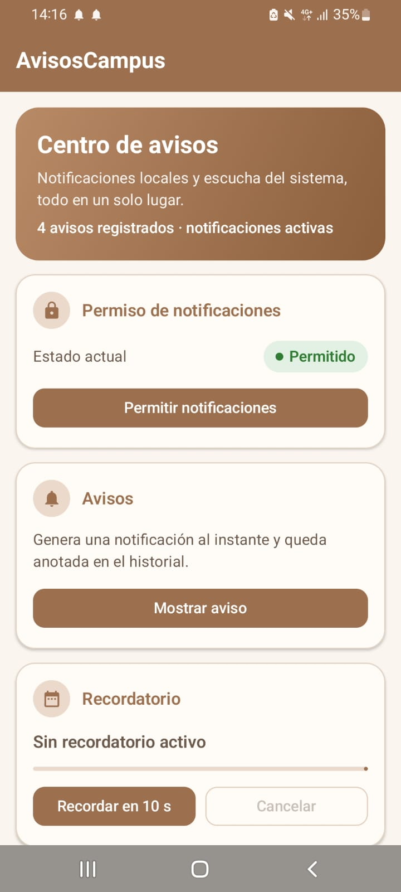
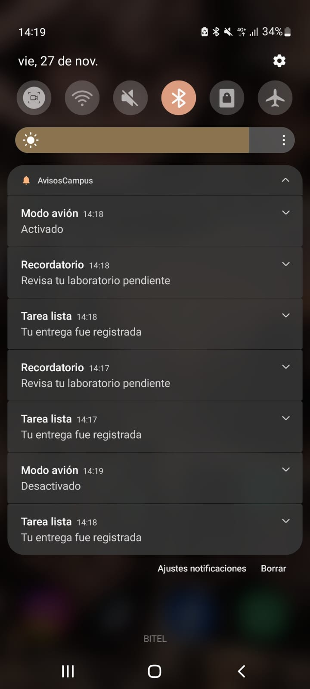

# AvisosCampus

App Android que muestra notificaciones locales, programa un recordatorio con corrutinas y escucha el modo avión con un `BroadcastReceiver`. Todo queda registrado en un historial.

**Tecnología:** Kotlin · Jetpack Compose · Material 3 (tema marrón claro) · MVVM + Repository

## Estructura

```
com.ponce.avisoscampus/
├── AvisosApp.kt
├── MainActivity.kt
├── model/Modelos.kt
├── data/AvisosRepository.kt
├── notificacion/Notificador.kt
├── receiver/ModoAvionReceiver.kt
├── viewmodel/{AvisosViewModel, AvisosViewModelFactory}.kt
└── ui/{PantallaAvisos, HistorialAvisos}.kt + theme/
```

## Arquitectura

```
View (PantallaAvisos) --eventos--> ViewModel --registra--> Repository (interface)
        ^                              |
        |--- collectAsState() ---------+
        |--- SharedFlow<Aviso> --> Notificador.mostrar(context, aviso)
```

El ViewModel decide qué avisar y lo anota en el Repository; la pantalla (que sí tiene `Context`) llama al `Notificador`.

    
## Capturas

1. Centro de avisos pantalla principal:  
   

2. Historial:  
   

3. Notificaciones:  
   

## Para pensar

1. **¿Por qué una notificación necesita un canal y un permiso? ¿Qué pasa si falta cada uno?**
   * **Canal (`NotificationChannel`):** Desde Android 8.0 (API 26), agrupa las notificaciones por categoría para que el usuario pueda configurar su sonido, vibración o importancia sin silenciar toda la app. Si falta el canal en Android 8.0 o superior, el sistema bloquea la notificación silenciosamente y nunca se muestra (aunque no lanza excepción).
   * **Permiso (`POST_NOTIFICATIONS`):** Desde Android 13 (API 33), protege al usuario contra notificaciones no deseadas otorgándole control explícito. Si falta el permiso, `NotificationManagerCompat.notify()` no muestra nada en pantalla (y en llamadas directas sin comprobar permiso puede generar una `SecurityException`).

2. **¿Por qué el ViewModel emite un evento y no muestra la notificación él mismo?**
   * Para respetar la arquitectura **MVVM** y evitar fugas de memoria (*memory leaks*). Mostrar una notificación requiere un `Context` de Android (`Notificador.mostrar(context, aviso)`), y el `ViewModel` sobrevive a cambios de configuración como rotar la pantalla, por lo que nunca debe guardar referencias a `Context` ni conocer detalles del sistema o la UI. Emitir un evento (`SharedFlow`) deja que la vista (`PantallaAvisos`) ejecute `Notificador` usando su contexto seguro.

3. **¿Qué pasa si usas el mismo id en dos notificaciones?**
   * La segunda notificación **sobrescribe y reemplaza** a la primera en la barra de estado y en el panel de notificaciones en lugar de apilarse como una notificación nueva. Usar un `id` único por aviso (`aviso.id`) garantiza que cada alerta se muestre de forma independiente.

4. **¿Por qué `onReceive` debe ser corto y por qué hay que quitar el receptor al salir?**
   * **`onReceive` corto:** Se ejecuta en el hilo principal (UI Thread) y Android le da un límite estricto (aproximadamente 10 segundos). Si realiza trabajo pesado o bloqueante, congela la interfaz y provoca un error **ANR** (*Application Not Responding*).
   * **Quitar el receptor (`unregisterReceiver` en `onDispose`):** Un `BroadcastReceiver` registrado dinámicamente mantiene una referencia al `Context` de la pantalla. Si no se desregistra al salir o recomponer, provoca una fuga de memoria y sigue escuchando eventos del sistema cuando la pantalla ya no está activa.

5. **¿En qué casos usarías una notificación local y en cuáles una push de Firebase?**
   * **Notificación local:** Cuando el evento se origina dentro del propio dispositivo sin depender de un servidor externo, como recordatorios programados, temporizadores, alarmas o cambios de estado del celular (modo avión, batería baja).
   * **Notificación push (Firebase Cloud Messaging):** Cuando el evento ocurre en la nube o proviene de otro usuario y debe llegar incluso con la app cerrada, como mensajes de chat, alertas de pedidos, avisos institucionales masivos o actualizaciones en tiempo real desde un backend.

